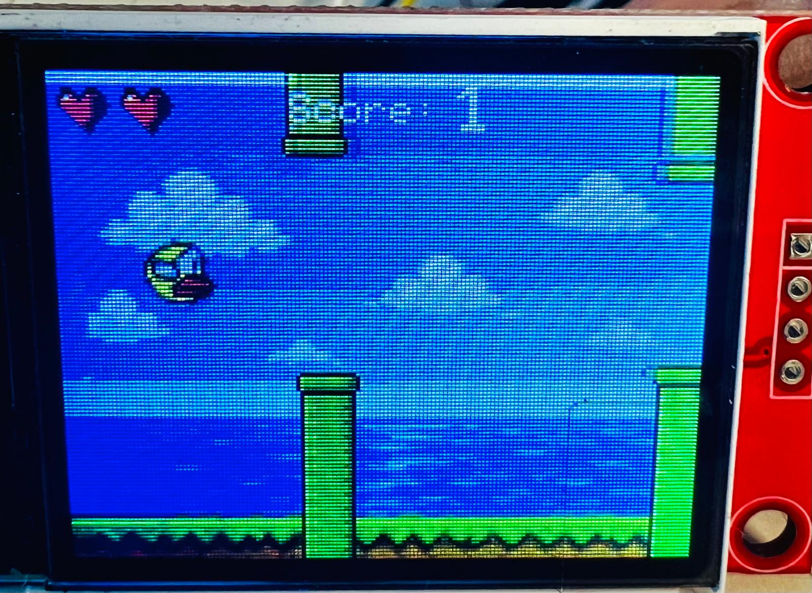

# Flappy Bird for ESP32

A retro-style Flappy Bird game running on an ESP32 microcontroller.

Built with **ESP-IDF** and **LovyanGFX**, featuring custom pixel-art graphics on a 1.8-inch TFT display.

## Demo

![Flappy Bird running on ESP32]
<p align="center">
  
</p>

## Hardware

- ESP32 development board (ESP-WROOM-32)
- ST7735 TFT display (128 × 160, SPI)

## Software

- ESP-IDF 5.5
- C++
- [LovyanGFX](https://github.com/lovyan03/LovyanGFX) 1.2.33

## Getting Started

### Clone the repository

Clone the project together with its Git submodules:

```bash
git clone --recurse-submodules https://github.com/vladislav1975/FlappyBird.git
cd FlappyBird
```

### Set up ESP-IDF

Activate your ESP-IDF environment:

```bash
. ~/esp-idf/export.sh
```

### Build

```bash
idf.py build
```

### Flash

Connect your ESP32 board and run:

```bash
idf.py flash
```

To specify the serial port:

```bash
idf.py -p PORT flash
```

Replace `PORT` with your ESP32 serial port.

## Project Status

Successfully built and tested on real ESP32 hardware.

## Dependencies

LovyanGFX is included as a Git submodule, pinned to version **1.2.33**.

Make sure to use `--recurse-submodules` when cloning the repository.
